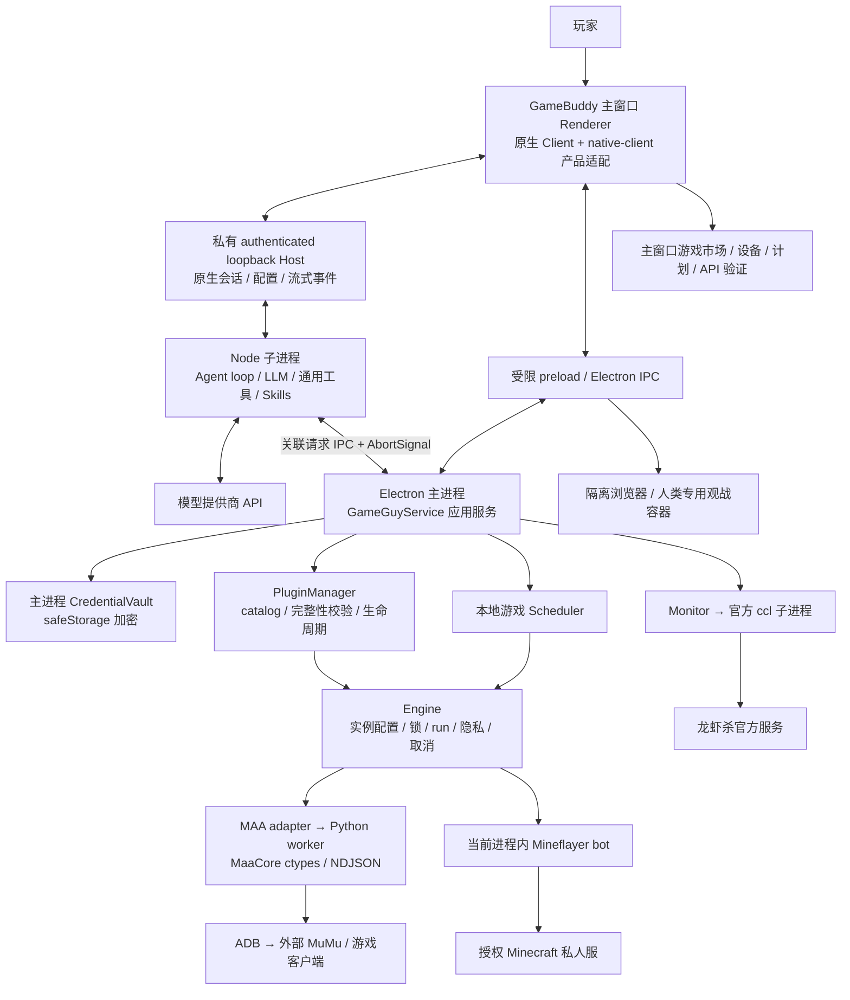

# GameBuddy

**陪你玩，帮你干。以游戏能力为核心的通用 AI Agent 桌面产品。**

GameBuddy（助手称呼 **Buddy**）通过对话理解玩家目标，发现环境、配置游戏工具、执行任务、展示游戏现场并汇报结果。资料检索、文件操作、终端、脚本编写、计划与子 Agent 是同一个 Agent 的基础能力，用来辅助完成游戏或工作任务，而不是另一套简化聊天系统。

> **当前状态：v0.3 源码开发原型，Windows 优先。** 已接入明日方舟 / Minecraft / 龙虾杀三个独立游戏包；市场目前是内置离线可信目录，不是已经上线的远程下载商店。UI、模型路由与执行合同已有自动化验证，但不能由此推导所有真实游戏目标已验收。
>
> 本文按 **2026-10-28 当前源码**整理，是当前项目架构入口。产品展示名已改为 GameBuddy；目录、数据和内部 `gameguy` 标识保留兼容。旧设计文档中的历史描述不应覆盖本页明确列出的实现边界。

## 导航

- [快速开始](#快速开始)
- [产品能力与游戏范围](#产品能力与游戏范围)
- [总体架构与进程边界](#总体架构与进程边界)
- [模块职责](#模块职责)
- [启动流程与配置所有权](#启动流程与配置所有权)
- [对话到游戏执行的数据流](#对话到游戏执行的数据流)
- [游戏市场与插件体系](#游戏市场与插件体系)
- [三个游戏的后端实现](#三个游戏的后端实现)
- [权限隐私与停止语义](#权限隐私与停止语义)
- [模型接入与会话切换](#模型接入与会话切换)
- [调度与无人值守边界](#调度与无人值守边界)
- [目录与持久化数据](#目录与持久化数据)
- [开发构建与验证](#开发构建与验证)
- [已知缺口与发布门槛](#已知缺口与发布门槛)
- [技术来源与文档](#技术来源与文档)

## 快速开始

### 环境要求

| 项目 | 要求 / 说明 |
| --- | --- |
| 操作系统 | 当前主要开发和桌面验证平台为 Windows；不承诺 macOS/Linux 功能对等 |
| Node.js | 外部 **Node 24+**，可从 PATH 运行；不是直接用 Electron 内置 Node 替代 Agent Host |
| npm | 使用仓库锁文件 `npm.cmd ci` 安装依赖 |
| Electron | npm 固定 **39.2.7**；首次安装不要加 `--ignore-scripts`，否则可能缺少运行时 |
| 模型 | 在设置中配置可用提供商、模型与凭据；目录接口和推理接口需分别检查 |
| 明日方舟（按需） | 64 位 Python **3.12+**、MAA/MaaCore 和资源、ADB、已安装游戏的模拟器；游戏登录由玩家完成 |
| Minecraft（按需） | 玩家授权的 Minecraft Java `offline-mode` 私人测试服 |
| 龙虾杀（按需） | 官方 ccl CLI **0.9.1** 已列为精确 npm 依赖，身份按官方流程配置 |

### 安装与启动

在当前源码目录执行：

```powershell
Set-Location D:\Gameguy
npm.cmd ci
npm.cmd run build
npm.cmd start
```

已完成安装和构建后，可双击 **[Start-GameBuddy.cmd](Start-GameBuddy.cmd)**。旧的 [Start-GameGuy.cmd](Start-GameGuy.cmd) 仍可用。修改源码后重新构建，再启动新版本；已有旧窗口请自行从托盘退出，不要依靠第二次启动覆盖运行中的单实例。

**不需要启动原版 DSH Desktop、旧 `18765` Web 服务或外部浏览器。** 主界面运行在 GameBuddy 自己的 Electron 窗口中。内部使用本机 HTTP Host 是客户端通信方式，不代表产品入口是浏览器网页。

### 玩家使用路径

1. 在 **设置 → 模型** 添加提供商，获取模型列表并验证推理 API。
2. 打开 **游戏市场**，安装并启用需要的游戏包；也可以在对话中要求 Buddy 发现并安装可信目录内的游戏包。
3. 直接说需求，例如：**“帮我连接明日方舟，官服，只收基建，不换班、不购物、不吃药、不用无人机。”**
4. Buddy 先读取 Skill 并发现依赖和实例，只追问无法自动确定的信息；玩家不用先学会写 MAA JSON。
5. 按当前权限模式确认配置/执行，完成游戏内登录，再观察右侧步骤、画面和结果。需要时停止或隐私暂停。

首页提供“游戏 / 工作”入口和已安装游戏的能力示例：**悬停或键盘聚焦仅在输入框内预览提示词；点击填入可编辑草稿，绝不直接发送。** 用户手动发送才调用模型。已编辑草稿、附件和引用不会被示例静默覆盖。

## 产品能力与游戏范围

### 通用工作台

主窗口接入完整原生 Agent 工作台，再通过产品模块适配品牌、首页和游戏能力：

- 流式对话、Markdown/代码块、会话模型切换、提供商支持的推理强度。
- 工作区、附件、`@` 引用、`/` 命令；会话搜索、重命名、置顶、分叉、归档。
- 计划 / 目标 / todo、工具轨迹、子 Agent、jobs。
- 文件、终端、文档/产物/diff、隔离浏览器、主题、语言和快捷键。
- 模型提供商、Agent 预设、通用插件/MCP、权限和问答配置。
- 游戏市场与同会话游戏现场：安装状态、步骤、画面、错误、停止、隐私、结果摘要；技术 JSON 默认折叠，按需挂载。

这些是已接入的模块范围，不是“所有外部 MCP/provider、全部交互和真实游戏均已验证”的承诺。

### 游戏能力矩阵

| 游戏包 | 当前实现 | 明确未实现 / 不保证 |
| --- | --- | --- |
| **明日方舟 0.3.7** | MAA Skill、依赖/模拟器发现、自然语言需求编译、配置、设备启动和诊断；基建收取、普通自动换班/已有自定义方案、好友信用、可选购物、奖励与邮件、有限刷关和肉鸽；ADB 截图、每日模板 | 受管理插件未暴露游戏内方案 `mode=20000` 和完整公开招募；登录不是 Agent 自动代输密码；不保证最优排班、严格折扣购物、肉鸽通关或奖励独立核验 |
| **Minecraft 0.3.2** | Mineflayer adapter + Skill；授权 Java offline-mode 测试服 `observe / goto / dig`、有界状态和停止 | Microsoft/线上账号认证、craft/equip、任意建造、完整石镐目标、独立 worker 隔离未完成 |
| **龙虾杀 0.3.1** | 官方 Skill 包、原始 ccl 命令、受管理前台长连接 Monitor、事件唤醒、官方网页观战 | 不重包 `speak/vote` 为虚构 gameplay API；本地停止不证明远端退房；真实完整对局、断线恢复仍需专项验收 |

市场文案和首页提示词是**需求入口**，不是可执行能力证明；实际执行范围以插件 schema、Skill、宿主校验和真实回执为准。

## 总体架构与进程边界

### 核心设计

1. **一个通用 Agent，多种游戏能力。** 不为每个游戏重写 Agent loop、模型系统或对话历史。
2. **游戏语义归插件，生命周期归宿主。** MAA 参数、环境发现和任务编译放在明日方舟包中；宿主负责会话归属、权限、存储、实例锁、取消与调度。
3. **Skill 和 adapter 分工。** Skill 告诉 Agent 如何理解、配置、执行和验收；adapter 提供可校验的受管理执行接口。已有正式 CLI 的游戏可以只提供 Skill。
4. **产品是独立桌面应用。** 框架模块是内部技术复用。

### 运行图



| 进程 / 容器 | 运行内容 | 边界 |
| --- | --- | --- |
| Electron 主进程 | 窗口、托盘、IPC、应用服务、Engine、插件管理、游戏调度、凭据；当前 Mineflayer 也在此执行 | 游戏 adapter 是可信本机代码；没有自动 OS 沙箱 |
| 主窗口 Renderer | 原生客户端和 GameBuddy UI Slot；模型/会话控件、市场、首页、游戏现场 | 关闭 Node integration，保留 contextIsolation / sandbox / webSecurity |
| 外部 Node 子进程 | 固定框架 profile、私有 Web Host、Agent、通用工具、会话与 Skill 注册 | 与主进程通过相关联消息调用；凭据访问通过主进程桥 |
| MAA Python 子进程 | 加载 MaaCore、执行已编译任务，回传结构化事件 | 进程生命周期受管理；不是自动免除本机权限或许可责任的安全沙箱 |
| ccl 子进程 | 官方前台 start/join stream | Monitor 管理单账号流、期限、取消和通知，不接管所有 gameplay 命令 |
| Browser guests / 观战 WebContentsView | 用户浏览页面和官方观战 | 不附应用 preload/写入桥；观战只给人，不给 Agent 隐藏视野 |
| MuMu / 游戏 / 服务器 | 外部依赖 | GameBuddy 未将模拟器窗口真正嵌入；不承诺关闭外部游戏来实现停止 |

主工作台 HTTP Host 监听 `127.0.0.1` 动态端口、使用认证 URL，不能当成面向公网的服务器。以上隔离主要保护应用桥和页面访问边界，**不等于允许在插件中安全执行任意不可信代码**。

## 模块职责

项目是 npm workspaces，TypeScript 用 project references 构建，桌面/桥接层主要为 ESM。

| 模块 / 入口 | 负责 | 不负责 |
| --- | --- | --- |
| [desktop](packages/desktop/main.mjs) | Electron 生命周期、单实例、托盘、可信窗口/IPC、凭据、目录选择、快捷键、browser guests、官方观战 | 不理解 MAA 的关卡/干员/任务参数 |
| [native-client](packages/native-client/client.js) | 正式 Slot 上的品牌、首页、游戏市场、右侧游戏现场；连接原生会话和桌面桥 | 不替换原生编辑器、模型选择器或 Agent loop |
| [agent-extensions](packages/agent-extensions/index.mjs) | 固定版通用插件管理页面的产品级适配，作为高级入口保留通用扩展能力 | 不是游戏市场后端；不改上游 checkout/node_modules |
| [desktop/startup](packages/desktop/startup.html) | 启动状态、错误重试与模型连接恢复 | 不提供旧版聊天或游戏中心 |
| [ui](packages/ui/index.html) | 仅供隔离兼容测试的旧界面 | 不参与产品启动或故障恢复 |
| [app-service](packages/app-service/index.mjs) | task↔原生 session 绑定、业务工具入口、根 Agent 归属、实时权限、审批/问答、插件生命周期、模型快捷配置、事件/结果唤醒 | 不自行推理玩家目标；游戏计划语义交给插件 |
| [runtime-dsh](packages/runtime-dsh/worker.mjs) | boot 原生 profile、LLM 和原生工具；注册产品身份/Skills/业务工具；session adoption、事件、模型和权限桥；SDK 兼容支路 | 不另造一套简化模型轮询循环 |
| [core](packages/core/src/engine.ts) | `GamePlugin` 合同、实例/设备互斥、运行状态、deadline/AbortSignal、截图隐私、持久化和清理 | 不含游戏专属策略；不保证任意脚本也受管理 |
| [scheduler](packages/scheduler/index.mjs) | 每日 `HH:mm + IANA 时区` 模板、occurrence claim、漏跑/中断策略 | 不在每次触发时重新让 LLM 制订消费计划；不是云调度 |
| [plugin-arknights](packages/plugin-arknights/src/index.ts) | MAA 参数、自然语言需求 schema/编译、发现、MuMu/ADB、worker、游戏 Skill | 不掌握通用会话权限；未接入所有 MaaCore 能力 |
| [plugin-minecraft](packages/plugin-minecraft/src/index.ts) | Mineflayer 配置和动作校验、连接、状态、动作、清理、Skill | 不承诺支持任意 MC 插件/服务器/账号认证 |
| [plugin-clawclaw](packages/plugin-clawclaw/home.json) | 产品首页能力元数据；构建时引用官方 Skill，manifest 声明 CLI 精确依赖 | 没有自造的 speak/vote adapter，官方玩法不复制成另一协议 |

宿主还有三个重要组成：

- [PluginManager](packages/app-service/plugins.mjs)：唯一市场库存来源，管理 adapter / skill / script。`core/contracts.ts` 中的静态两 adapter 列表不是市场全量目录。
- [MonitorService](packages/app-service/monitor.mjs)：管理官方 ccl 长连接和 NDJSON，不是 shell 命令任意执行器。
- [Store](packages/app-service/storage.mjs)：JSON 快照串行写入、临时文件 + rename；无文件用初值，坏 JSON 报错，不伪装初始化成功。不是关系型数据库或跨进程事务系统。

## 启动流程与配置所有权

```text
Start-GameBuddy.cmd / npm start
  → launch-product.mjs：确认已构建，解析并校验 Electron runtime
  → desktop/main.mjs：单实例锁、userdata、窗口、托盘、受限 IPC
  → GameGuyService.init：恢复存储、校验已启用包、初始化 scheduler
  → runtime-dsh/index.mjs：使用外部 Node fork worker.mjs
  → prepareNativeProfile + runProfile(web)：原生 Host / Agent / tools / session
  → 同步已启用游戏 Skills，返回 authenticated nativeURL
  → Electron 主窗口加载工作台，游戏市场及管理入口在主窗口内
```

- **框架基底**：固定 DeepSeek Harness **0.2.1-rc.2** 的 web/base profile 和客户端模块。参考 checkout `D:/Gameguy/dsh` 只读；生产入口在自有 desktop，不从该 checkout 启动上游 Desktop。
- **首次 bootstrap**：[native-profile.mjs](packages/runtime-dsh/native-profile.mjs) 初始化产品 persona、权限和原生 Agent 预设/模型。初始化完成后，可编辑 profile 由原生设置管理，重启不会覆盖用户设置。
- **部署 overlay**：配置动态 loopback Host、产品模块、工作区与会话路径、凭据桥；禁用上游官方账号、产品/会话遥测等运营模块。禁用内置遥测不表示所有第三方扩展或模型服务都离线。
- **身份配置**：[AGENT.md](AGENT.md) 定义产品身份，[persona.mjs](packages/runtime-dsh/persona.mjs) 组合执行约束，[product-identity.mjs](packages/runtime-dsh/product-identity.mjs) 注入独立身份段并兼容旧产品前缀；不重写自定义 persona 或历史。仓库执行记忆放在 `AGENTS.md`（本地仓库记忆，不随源码上传），两者用途不同。
- **主路 / 兼容支路**：正式产品使用原生 web profile；SDK/辅助界面路径保留回归和兼容用途，不应把它当成正式主工作台，也不建议用 `legacy:*` 启动日常产品。

Windows 启动器会把 npm Electron 的完整发行字节清单复制并校验到 `%LOCALAPPDATA%\GameGuy\runtimes`。损坏缓存从安装源重建到新 recovery generation，不修改/删除另一进程仍可能使用的旧 generation。仅允许运行时生成的根 `debug.log` 不参与 immutable inventory；DLL/PAK/exe/未知附加文件仍校验。**不关闭 Chromium 沙箱、不修改系统 ACL、不下载另一个 Electron 版本来绕过校验。**

## 对话到游戏执行的数据流

### 通用请求

用户在原生输入框手动发送 → 原生 sessionController / Agent → 当前会话模型 → 通用工具 → 工具结果和流式回复。主窗口会话由应用服务收养为产品 task，建立 `taskId ↔ sessionId` 关联；原生对话记录仍由框架 session 系统负责。产品 task 存游戏配置、运行关联、事件和 UI 摘要，不取代完整原生历史。

普通工作请求不要求绑定游戏；选择或绑定游戏也不会裁掉文件、终端、检索、脚本、测试等通用工具。

### 明日方舟示例：只收基建

```text
玩家：“只收基建，不换班、不购物，不吃药、不用无人机”
  1. catalog/install      找到并启用可信明日方舟包（已启用则复用）
  2. skill                读取包内操作说明与官方脚本参考
  3. setup                插件有限环境发现：MAA / Python / ADB / MuMu / 实例
  4. 对话追问              只解决缺失的渠道、实例或玩家目标，不要求手写 JSON
  5. prepare              纯编译：proposedConfig、plan、步骤预览、风险和问题
  6. configure            校验并授权保存配置，绑定当前 task 的 instance
  7. device_start/diagnose 按需启动/连接；ready 不是登录成功，玩家处理登录
  8. run                  应用服务校验 plan 和实时权限，Engine 获得实例/设备锁
  9. Python MaaCore       插件编译任务 → worker → MAA → ADB → 游戏
 10. event/result         事件持久化、UI 刷新、异常或结束事实唤醒同一 Agent
 11. Buddy 汇报            区分 started、后端完成、目标/奖励独立核验
```

`prepare` 是插件定义 schema 的确定性编译器，不是另一个 LLM：Agent 把玩家意图转换为该 schema。编译仅返回提案，**不保存配置、不启动设备、不执行、不创建日程**。`connect` 请求不应夹带消费动作；玩家问题仍未解决时不应报告可运行。

当前基建仅收取编译为 MAA `Custom → InfrastBegin`，不换班、不点游戏内一键轮换、不处理线索；交付订单可能正常消耗基建订单货物。任务默认 `startup=true`，编译的 `StartUp.start_game_enabled=true`，不要重新引入“游戏未在正确界面但禁止 startup”的旧问题。

### 运行、事件和恢复

- 业务工具参数先由应用服务严格校验；游戏配置/计划由已安装 adapter 再校验。`Engine.run` 不自行理解 MAA 计划，不能绕开应用服务/adapter 的验证直接执行任意 JSON。
- 运行创建前保存 run，获取实例及设备 ownership；同一 ADB 地址的 `localhost` 与 `127.0.0.1` 端点规范化，MuMu 安装/实例也参与 ownership。
- `gameguy_run` 立即返回 **started + runId**，后端异步执行；期限为 **10–7200 秒**，默认 **900 秒**。无需卡住工具等待完整剿灭/肉鸽结束。
- 事件用于步骤和状态，失败/断连或最终结果可唤醒 Agent；外部游戏事实标记为 **untrusted facts**，不能当作新指令。ccl 流的通知先持久化再 steer。
- 最终结果持久化后交付，完成通知带去重标记；子任务成功/失败不替代整条任务回执。Engine 每个 run 最多保留 200 条事件，已完成历史最多 1000 条；不是无限完整原始日志库。
- 上次退出仍在进行的任务/运行标为 `interrupted`，不自动重试可能已消费的动作。设备 records 是保存的连接/启动操作，**空 records 不能证明模拟器未运行**；应以插件官方 CLI/ADB 诊断为依据。

状态必须分层解读：

| 状态 / 证据 | 能说明什么 | 不能说明什么 |
| --- | --- | --- |
| 环境发现 | 找到依赖、候选实例或配置证据 | 已连接、已登录 |
| device ready / ADB device | 设备启动/端点可用 | MAA 可完整执行、游戏首页可识别 |
| run started | 后端已接收并启动 | 收菜完成 |
| run completed / MAA 链完成 | 后端报告任务结束 | 所有奖励到账、玩家完整目标已独立核验 |
| stopped | 已确认本地受管理执行停止 | 已发生动作撤销、远端退房、所有自写脚本已停止 |
| interrupted / unknown | 上次中断或停止结果不确定 | 可以无风险直接重跑 |

## 游戏市场与插件体系

### 当前市场

**三个游戏是三个包**，统一通过市场安装/启停；龙虾杀包内仍直接复用官方 Skill，不需要为了“插件化”重写发言/投票接口。

- 可信目录：[product/catalog.json](D:/Gameguy/product/catalog.json)。源包：`D:/Gameguy/product/plugins/<id>`。
- 已安装包：`D:/Gameguy/product/installed/<dataDir 指纹前20位>/<id>-<version>`；指纹为 `sha256(JSON.stringify(dataDir))`，不是明文账号，不是 `%APPDATA%/plugins`。
- “安装”是本地清单校验 → staging 复制 → 再校验 → 原子 rename → 启用；本版不发生网络下载。
- `tasks.json.enabled` 保存启用状态；安装状态每次启动扫描和校验实际目录。启用后同步后端注册与原生 Skill 注册，失败不冒充成功；停用保留包、配置和历史。
- 有活动 run、发现/诊断、审批或 ccl stream 时先停止，不能只把按钮改成“停用”。停用不会让模型忘掉已经读入当前上下文的 Skill。

### 包合同

catalog 绑定 `id / version / kind / permissions / dependencies / manifestSha256` 以及标题、描述、首页能力等元数据。manifest API v1 包含入口和 `files[{path, sha256}]`；catalog 的 manifest 摘要再绑定文件清单。

| kind | entry | 启用行为 | 执行边界 |
| --- | --- | --- | --- |
| `adapter` | `lib/index.js` | import adapter，校验公共合同并 `Engine.register`，同步 Skill | 使用受管理配置/计划、锁、期限、事件和清理 |
| `skill` | `skills/<id>/SKILL.md` | 检查固定依赖，只注册 Skill | 原始 CLI/通用工具；龙虾杀 stream 额外接 Monitor |
| `script` | `skills/<id>/SKILL.md`，另有 `scripts/` | 注册 Skill；安装不执行脚本/npm lifecycle | Skill 指导 Agent 经通用工具运行；**不自动继承 adapter 的资源/停止/调度保障** |

安装拒绝 symlink、目录逃逸、清单外文件、哈希不符、版本/权限/home/依赖与可信目录不符。依赖精确版本不满足则失败，**不会偷偷 npm install 任意依赖**。清单摘要提供本地完整性，不是已部署的发布方数字签名或第三方信任体系。

### adapter 合同

真实类型定义见 [contracts.ts](packages/core/src/contracts.ts)：

```text
必须：id / title / defaults / parseConfig / configSchema / planSchema
      validatePlan / capabilities.schedule / questions / diagnose / execute
可选：setup / requestSchema + prepare / screenshot / control
      deviceKeys / deviceLaunch / startDevice / dispose
execute 接收：config、plan、GameRuntime{signal, event, deliver?, preview?}
```

`setup` 属于插件的有限环境发现；`prepare` 是纯提案生成；`execute` 必须响应取消和清理自己拥有的资源。可选 `control` 接口存在，不表示产品已向 Agent 开放视觉点击/登录工具。

应用服务提供发现/安装/读取 Skill/setup/status/stop 等基础工具，以及已接入 adapter 的 configure/prepare/diagnose/run。明日方舟再加 device_start/schedule 管理，龙虾杀加 preview/Monitor。**业务作用域不影响原生通用工具，但宿主会检查当前 task、实例、插件和根 Agent 归属。** Minecraft 尚无 `prepare` 实现；调用会明确返回不支持。

### 首页能力元数据

三个源码包各自定义 `home.json` 的 `actions[{id,label,prompt}]`。构建时校验并写入 manifest/catalog，安装时比对；UI 从真实已安装状态读取，不单独硬编码“假已下载”卡片。元数据只决定需求示例，不授权执行。产品通过 `hero.brand`、`conversation.input.dock`、`conversation.input.overlay` 等正式 Slot 扩展；几何样式仍依赖固定版原生类名，升级须回归。

### 新增游戏或脚本

**Skill/script 包**：准备只含 `skills/<id>/SKILL.md` 和可选 `scripts/` 的源目录；descriptor 放源目录外。用 [game-package.mjs](packages/app-service/game-package.mjs) 中 schema 定义 id、kind、版本、权限、固定依赖和可选 home。

```powershell
Set-Location D:\Gameguy
npm.cmd run package:game -- D:\path\descriptor.json D:\path\source D:\path\absent-output
```

输出必须不存在且不能在源目录内。命令生成包和旁边 `<output>.catalog.json` 作者回执，不执行包内代码。审查后将包及条目加入可信分发目录，再从市场安装。**当前 `build-product.mjs` 会重建三个内置包及 catalog，自定义分发需调整构建来源，不能只手改生成 catalog 然后期待下次 build 保留。**

**新 adapter**：实现上述合同和 Skill，接入构建/可信目录，并扩展应用服务参数 schema、业务工具作用域和必要 UI，补资源限制、取消/锁/恢复测试。当前 configure/prepare schema 和 policy 仍明确列出已支持游戏，**不是写一个 adapter 就能零宿主修改支持所有游戏**。

## 三个游戏的后端实现

### 明日方舟：插件知识 + MaaCore worker

- 源码：[plan.ts](packages/plugin-arknights/src/plan.ts) 定义配置/任务/资源上限，[prepare.ts](packages/plugin-arknights/src/prepare.ts) 定义玩家意图编译，[discovery.ts](packages/plugin-arknights/src/discovery.ts) 与 [emulator.ts](packages/plugin-arknights/src/emulator.ts) 发现和控制 MuMu。
- 知识：[SKILL.md](packages/plugin-arknights/skills/arknights/SKILL.md) 及 `references/official-scripts.md / connection.md / tasks.md / schedule.md`，让 Buddy 能按官方库说明自己配置、诊断和必要时写脚本。
- 执行：[worker/maa.py](packages/plugin-arknights/worker/maa.py) 经 Python ctypes 加载用户 MAA，stdin 接任务/stop，stdout NDJSON 回传事件/result；异常、超时、输出预算和取消由插件/宿主处理。
- 基建：受管理插件提供 `baseCollect`、普通 `mode=0` 和自定义 `mode=10000`；**游戏内保存方案 `mode=20000` 在现有独立日常脚本支路，不在插件 schema 中**。
- 资源：受管理计划固定源石 0、无人机禁用、不补原料、不抽卡/充值；药量和刷关次数不得超过已授权配置。本仓库玩家现有约束还要求药 0。临期药参数在当前 MAA 中不是可靠瓶数上限，因此插件拒绝非零临期药，不假装限量实现。
- 购物：好友访问与信用购物分开授权；信用购物没有数值预算上限，`only_buy_discount` 不保证“严格只买折扣”。要求严格折扣/预算时先说明能力不足，不偷偷放宽。
- 预览：通过 ADB PNG 截图限频刷新，供人观看；不是视频直播，不是把 MuMu 原生窗口嵌入，也不是默认发送图片给模型。

### Minecraft：有界协议动作

每次 run 创建一个 bot，完成/取消后清理连接；每 2 秒回传位置、血量、饥饿、背包和玩家等结构化状态。挖掘必须 `allowDig=true` 且不超过配置次数；目前配置最大 16 块、半径最大 8。pathfinder 禁止自动挖路、搭柱、跑酷和脚手架，避免把移动偷偷扩大为破坏性行为。

TCP 诊断成功只证明端口可达，不证明版本或账号可登录。当前进程内执行没有单独 worker 故障隔离；仍需在玩家授权私人服实测，而不是把有限动作宣称为完整自主生存。

### 龙虾杀：官方 Skill + ccl

构建从固定 `@myclaw163/clawclaw-cli@0.9.1` 提取官方 Skill。Agent 根据 Skill 使用原始 ccl 发言/投票等命令；前台 start/join 长连接必须由 Monitor 管理，不在 shell 中偷偷后台启动流。

Monitor 接受直接 ccl argv，拒绝 shell 拼接/重定向和 `--force`，全局只拥有一个活动账号流，最长 30 分钟，限制输出大小；事件经规范化、持久化、去重后唤醒当前 task。观战只允许官方 `myclaw.163.com` HTTPS 来源，以隔离 WebContentsView 在产品里显示；不能把观战中的隐藏信息送回 Agent。

## 权限隐私与停止语义

### 与原生权限一致

- 保留原生只读、工作区写入、完全访问与单次授权，支持全局默认和会话配置。
- 游戏操作读取**当前根会话的实时权限**。当 `sandboxMode=danger-full-access` 且 `approvalPolicy=never` 时，通过校验的受管理游戏操作不再弹第二张审批卡，先落授权审计再执行。
- 其他模式、权限未知、会话不匹配或内核离线均保留确认；不相信 task 缓存或 UI 标签来推断授权。UI 市场安装自身仍有来源/权限确认对话框。
- 完全访问不取消资源上限、根 Agent/实例归属、隐私、设备锁和停止规则；玩家问题/选择不是授权卡，不会自动替玩家作答。
- 根 Agent 拥有游戏 effects 和审批；子 Agent 可辅助检索/代码/测试，不获得代用户批准或控制其他任务的权限。

### 登录与隐私

密码、验证码、扫码等在游戏客户端完成，不在聊天中提交。模型 Key 用设置页保存。隐私暂停先阻断画面并请求停止，再保存设备隐私状态；截图读取前后检查隐私、实例和预览版本，变化时丢弃结果。恢复失败继续保持暂停，避免失败后曝光。

**隐私暂停只约束产品受管理画面/游戏流程**，不是对任意插件、通用 shell、自写脚本或第三方扩展的系统级信息防泄漏保证。

### 停止和自修复

stop 会取消发现/诊断、待审批/问答、Agent、受管理 ccl 流和 Engine 执行，并等待清理；工具取消从 Host cancel 传到 AbortSignal，不能留下永远等待的审批卡。只有确认清理后才显示 stopped；未确认显示 unknown，不能假称安全结束。

Buddy 可以自己写缺少的脚本、检查日志和运行测试，但**脚本不会因为是 Buddy 写的就自动接入 Engine 的锁、资源校验、停止和日程**。必要时应实现正式 adapter 或明确脚本的独立生命周期与风险；游戏动作已发生就不能撤销，失败后不盲目消费式重试。

## 模型接入与会话切换

- **原生设置**支持多提供商、协议和凭据，并拥有可编辑 profile；不需要为每次原生在线设置更改重启 Host。
- **输入框模型选择器**切换当前会话的下次请求，历史保留、在途请求不变；推理强度按 adapter 元数据提供，不猜测模型 ID 或 effort。
- **游戏市场 → API 验证**支持临时获取模型目录和验证 API，不保存配置、不修改会话模型。要添加或保存提供商，请使用主窗口“设置 → 模型”；启动失败时，新恢复页提供必要的模型连接设置。
- 获取模型目录不等于推理成功。API 验证发送一个小文本请求，可能产生费用；目录接口缺失时可填写提供商真实 ID。当前确定性端到端协议重点为 OpenAI completions，不保证所有协议/真实提供商都已验收。
- 原生凭据保存在主进程 `native-credentials.bin`，快捷路由兼容文件为 `credentials.bin`，均用 Electron safeStorage 加密；没有明文保存回退。凭据在调用时必须进入本机进程/模型请求，加密落盘不代表内存、会话或所有日志都无敏感信息。

## 调度与无人值守边界

当前存在三条不同机制，不能混为“同一个每天收菜系统”：

| 机制 | 配置与执行 | 离线/漏跑与适用范围 |
| --- | --- | --- |
| **GameBuddy 游戏 scheduler** | `gameguy_schedule / schedule_manage` 保存明确授权的 MAA plan、实例、配置指纹、时间、时区和期限；到点直接执行模板 | 必须本地服务和设备可用；离线/超时漏跑默认跳过；实例冲突跳过、配置变化不执行；不补消费动作 |
| **原生通用 jobs/调度工具** | 原生框架的通用 Agent 任务机制 | 不因此获得 MAA adapter 的资源/设备/结果保障；应查其实际工具合同 |
| **既有 Windows 每日脚本任务** | `GameGuy-Arknights-Daily` → `scripts/arknights_daily.py` | 本机现有 11:00 Interactive 任务，设错过后补跑；策略与游戏 scheduler 不同，不能用一条的测试证明另一条 |

游戏 scheduler 每秒 tick，执行前先保存 occurrence claim 和下次时间；key 由 schedule、时区和当地日期分钟组成，保留最多 2000 条。重启后未完成 claim/started 标 interrupted，不自动重试；不是全局 exactly-once，也不能防止玩家手动重跑消费。

既有日常脚本按仓库记忆执行收基建 → 游戏内方案换班 → 龙门市区剿灭一次 → 公开招募 → 好友信用 → 购物 → 日常/周常/邮件。它是已有兼容实现，不是受管理插件全能力已经交付的证明。**同一天重跑仍可能再次消耗自然理智；`times=1` 只约束本次，不等于每日防重复。** 两套定时机制可能争用同一设备，脚本不自动遵守 Engine 锁，不要对同一实例配置重叠任务。本次文档更新不执行或改动该任务。

关闭主窗口会进入托盘，本地服务仍在；显式退出停止服务。关机、休眠、退出时没有云端代跑，保持登录也不等于游戏始终能识别。

## 目录与持久化数据

### 仓库结构

```text
D:/Gameguy/
├─ README.md                     当前架构和开发入口
├─ AGENT.md / AGENTS.md           产品身份 / 仓库执行记忆
├─ gameguy-prd-v0.3.md            产品需求（需区分目标与已实现）
├─ package.json / package-lock.json / tsconfig.json
├─ Start-GameBuddy.cmd            正式启动；旧名启动器兼容
├─ packages/
│  ├─ desktop/                   Electron 主进程、桥、凭据和隔离浏览器
│  ├─ native-client/             主工作台产品 UI / 原生凭据桥
│  ├─ agent-extensions/          通用扩展页适配产物
│  ├─ ui/                        仅隔离兼容测试使用的旧界面
│  ├─ app-service/               task、工具入口、市场、Monitor、存储、模型
│  ├─ runtime-dsh/               profile、worker、身份、会话/权限/模型桥
│  ├─ core/src/                  Engine / 合同 / 进程工具
│  ├─ scheduler/                 自有游戏日程
│  ├─ plugin-arknights/           TS adapter + Skill + Python worker
│  ├─ plugin-minecraft/          TS adapter + Skill
│  └─ plugin-clawclaw/           产品元数据，官方 Skill 由构建提取
├─ product/
│  ├─ catalog.json               构建生成的可信市场目录
│  ├─ plugins/<id>/              构建生成的可安装游戏包
│  └─ installed/<fingerprint>/    用户数据隔离的已安装包版本
├─ scripts/                      构建/启动/打包/验证，以及兼容每日脚本
├─ tests/                        JS/TS 与 Python 回归
├─ artifacts/                    验证报告、图片与本地 tgz（非公开发布）
├─ docs/                         专题设计、历史验证与第三方声明
├─ assets/                       产品图标与视觉资源
├─ external/                     本机 MAA / platform-tools 等外部依赖
├─ downloads/                    本机下载留存，不是插件包内容
├─ dsh/                          上游参考源码，只读
└─ legacy/ / .runtime/           历史实现/运行数据，不是当前生产入口
```

### 用户数据与兼容标识

当前 userdata **仍是 `%APPDATA%\GameGuy-v03`，不是 `GameBuddy-v03`**。默认原生工作区在内核数据目录的 `workspaces` 下，玩家可选择其他目录。

```text
%APPDATA%/GameGuy-v03/
├─ tasks.json                    task/session 关联、游戏包 enabled、UI 摘要
├─ model.json / model-inventory.json  快捷模型连接（不含明文 Key）与目录
├─ credentials.bin               快捷模型兼容加密凭据
├─ native-credentials.bin         原生多提供商加密凭据 vault
├─ schedules.json                自有游戏模板和 occurrence
├─ engine/state.json             实例配置、runs、预览/设备隐私
├─ dsh-runtime/
│  ├─ sessions/                  原生会话 JSONL / 压缩策略
│  └─ workspaces/                默认原生工作区根
└─ runtime/arknights-adb/         插件临时 ADB 日志环境
```

框架 profile/settings 还由 worker 的 `DSH_HOME` 管理；Electron 自身会有缓存文件。原生会话搜索使用按需内存 SQLite 投影，不能把它误称为上述任务状态的主数据库。

保留 `@gameguy/*` 包名、`gameguy_*` 工具、`gameguy:*` IPC、缓存 `GameGuy` 路径和 Windows 任务名；不因改展示名强制迁移会话、模型、插件和日程。

**不要压缩整个仓库、`.runtime` 或 userdata 上传。** 会话、路径、设备/账号记录、临时日志和截图可能敏感；safeStorage 只覆盖指定凭据文件，不负责其余数据脱敏。

### 源码仓库内容边界

Git 上传仅包含源码、构建/验证脚本、产品说明和第三方许可。`node_modules/`、`product/` 生成包、`artifacts/` 验证产物、`external/`、`downloads/`、截图、会话、运行日志、个人 `AGENTS.md` 和本机配置均由 `.gitignore` 排除。克隆后先安装依赖并构建，再配置本机 MAA/ADB/Python 和模型；不从仓库恢复账号或凭据。历史验证报告路径仅表示原开发机证据，不意味着 GitHub 仓库附带这些数据。

当前 MAA 默认路径及部分兼容脚本依赖 `D:/Gameguy`；在其他目录使用时应通过插件配置设置实际路径，兼容每日脚本也须自行检查本机路径。源码下载不代表已安装游戏或已授权执行。

## 开发构建与验证

### 常用命令

```powershell
Set-Location D:\Gameguy
npm.cmd run typecheck           # TypeScript project references 检查
npm.cmd run build               # tsc + 三游戏包/manifest/catalog + 扩展页适配
npm.cmd test                    # 根测试清单中的 JS/TS + Python worker 测试
npm.cmd start                   # 正式桌面启动
npm.cmd run pack:plugins         # 本地可信包 tgz + 校验摘要，不发布
```

`build` 不含正式安装器、不下载 MAA/MuMu、不迁移用户数据。`pack:plugins` 包含 lib/Skill/manifest/必要 worker，不包含 node_modules、MAA 二进制、模拟器、账号和截图。输出在 `D:/Gameguy/artifacts/product-plugins`；以后可分发不代表现在已经获全部再分发授权。

| 验证命令 | 重点 |
| --- | --- |
| `verify:home-ui` | 真原生首页、悬停预览、可编辑草稿、只有手动发送请求模型 |
| `verify:native-desktop` | 主工作台会话/模型/工作区/权限/文件/终端/浏览器等 |
| `verify:native-market` / `verify:market-ui` | 原生市场及独立 React 市场组件 |
| `verify:dock-ui` | 游戏现场卡片、折叠技术详情、预览等 |
| `verify:identity` | 实际提示组装和本地模型身份夹具 |
| `verify:permissions` / `verify:product` / `verify:desktop` | 权限、服务/SDK 兼容支路与辅助中心 |
| `verify:model` / `verify:session-model` | 目录/API 和同会话下一次模型路由 |
| `verify:discovery` / `verify:onboarding` / `verify:maa-skill` / `verify:agent` | 发现、配置提案、MAA Skill 和 Agent 合同专项 |

专项命令不是一个已证明全覆盖的 CI 总入口；先看 [package.json](package.json) 的实际脚本和对应报告。夹具测试使用隔离 userdata 和本地模型服务，不应使用玩家游戏账号来替代确定性测试。

### 已有证据，不等于本次重新执行

2026-10-28 保存的 首页验证汇总（本地证据：`D:/Gameguy/artifacts/verification/gamebuddy-home-summary.json`，不随源码上传） 记录：

- 单测 **255 项（243 JS/TS + 12 Python）**。
- 原生首页 29 项（本地证据：`D:/Gameguy/artifacts/verification/home-ui/report.json`，不随源码上传）、原生工作台 53 项（本地证据：`D:/Gameguy/artifacts/verification/native-desktop/report.json`，不随源码上传） 通过。
- 首页悬停/示例点击 **0** 次模型请求，显式手动发送 **1** 次本地夹具请求；真实游戏动作和外部模型请求 **0**。
- 独立 React 市场 15 项（本地证据：`D:/Gameguy/artifacts/verification/game-market-ui/report.json`，不随源码上传）、原生市场 10 项（本地证据：`D:/Gameguy/artifacts/verification/native-game-market/report.json`，不随源码上传）、现场 UI 10 项（本地证据：`D:/Gameguy/artifacts/verification/game-dock-ui/report.json`，不随源码上传） 有各自报告，不能与全量桌面回归混为一项。

真实账号奖励核验、长时间无人值守、完整 MC 目标/龙虾杀对局需要单独实机证据。历史 `npm audit` 数字随时间变化，不能写成当前安全结论；公开发布前必须重新审计和处置，不能用 `npm audit fix --force` 绕过固定堆栈兼容性。

## 已知缺口与发布门槛

1. **远程市场**：注册表、托管、下载、签名/信任根、版本升级/回滚、第三方上传未交付；需 HTTPS 源策略、容量限制、安全解包、摘要/签名和更新测试。
2. **后端能力**：MAA mode=20000/公开招募仍在脚本支路；MC craft/equip/认证/worker；龙虾杀正式远端退出和断线恢复需要继续实现/验收。
3. **闭环核验**：started、后端完成和奖励验证分开；不能在未取得游戏事实时说“已收菜成功”。
4. **安装发行**：当前依赖外部 Node/Python 和源码目录；安装器、托管依赖、卸载/数据迁移、自动更新尚未完备。
5. **安全治理**：本机代码信任、插件授权粒度、日志脱敏、凭据/权限回归和当前依赖漏洞需要发布前复审。
6. **许可与游戏条款**：MAA AGPL、官方 Skill/CLI 再分发、专有模拟器/游戏资产和所有传递依赖须审查。独立 worker 不自动豁免许可义务。

## 技术来源与文档

GameBuddy 基于 [DeepSeek Harness](https://github.com/deepseek-ai/deepseek-harness) 的 Agent 设计和框架二次开发，复用固定版 MIT 会话、工具、profile 和客户端模块；自有产品层负责桌面宿主、身份/品牌、游戏市场、游戏执行编排和插件集成。技术说明如实保留来源，面向玩家的默认自我介绍只讲 Buddy 和可提供的帮助。

本仓库 npm 包目前为 `private`，未选定完整产品公开发行许可证，**不应仅依据上游 MIT 就宣称整个产品可任意公开分发**。第三方声明不等于已完成发行合规审计。

| 文档 | 用途 |
| --- | --- |
| [PRD v0.3](gameguy-prd-v0.3.md) | 产品目标与场景，不能将需求视为已实现 |
| [首页交互](docs/home-ui.md) | 原生 Slot、悬停预览、可编辑草稿与验证 |
| [游戏市场](docs/game-market.md) | 统一游戏/脚本包合同和市场专题 |
| [Agent 身份](docs/agent-identity.md) | 品牌身份与提示组装 |
| [使用说明](docs/usage.md) | 操作专题；较早段落需结合本文实现边界 |
| [框架接入对照](docs/dsh-parity.md) | 基础功能接入/验收记录 |
| [架构历史](docs/architecture.md) | 早期实现过程和决策，当前总览以本页为准 |
| [验证记录](docs/verification.md) | 历史 QA 和实机边界，以日期和原始报告为准 |
| [依赖记录](docs/dependencies.md) | 来源、下载哈希、历史版本/审计，不等于最新库存 |
| [第三方声明](docs/third-party-notices.md) | 代码改编来源和许可说明 |
